<div align="center">
  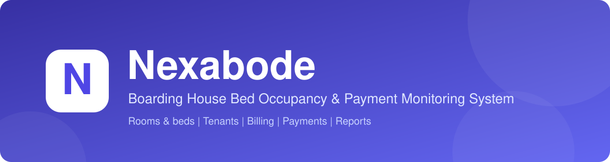
</div>

<br>

<table>
  <tr>
    <td width="50%"><a href="https://github.com/kvrtrss/Nexabode/releases/latest">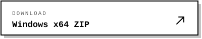</a></td>
    <td width="50%">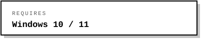</td>
  </tr>
</table>

<div align="center">
  <a href="#about">About</a> &nbsp;|&nbsp;
  <a href="#screenshots">Screenshots</a> &nbsp;|&nbsp;
  <a href="#features">Features</a> &nbsp;|&nbsp;
  <a href="#how-it-works">How It Works</a> &nbsp;|&nbsp;
  <a href="#download">Download</a> &nbsp;|&nbsp;
  <a href="#data-storage-and-backups">Data and Backups</a> &nbsp;|&nbsp;
  <a href="#build-from-source">Build from Source</a> &nbsp;|&nbsp;
  <a href="#contributing">Contributing</a>
  <br><br>
  <a href="https://github.com/kvrtrss/Nexabode/actions/workflows/build.yml"></a>
</div>

---

## About

Nexabode is a free, open-source Windows desktop application developed as an **academic project** to apply software development concepts to a practical boarding house management scenario. It brings rooms and beds, tenant occupancy, monthly rent, utility charges, payments, and outstanding balances into one place, as an alternative to notebooks and spreadsheets.

It is designed for local use. Data is stored on your computer in an encrypted database, with no online account required. Review the [security notes](#security-notes) and [disclaimer](#disclaimer) before storing real tenant or financial information.

<p align="center">
  
</p>

## Screenshots

<table>
  <tr>
    <td width="50%"><sub><b>01 / DASHBOARD</b></sub><br>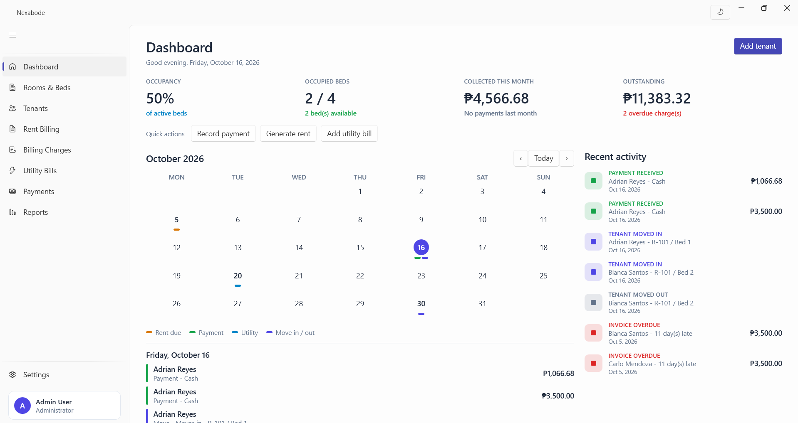</td>
    <td width="50%"><sub><b>02 / ROOMS AND BEDS</b></sub><br>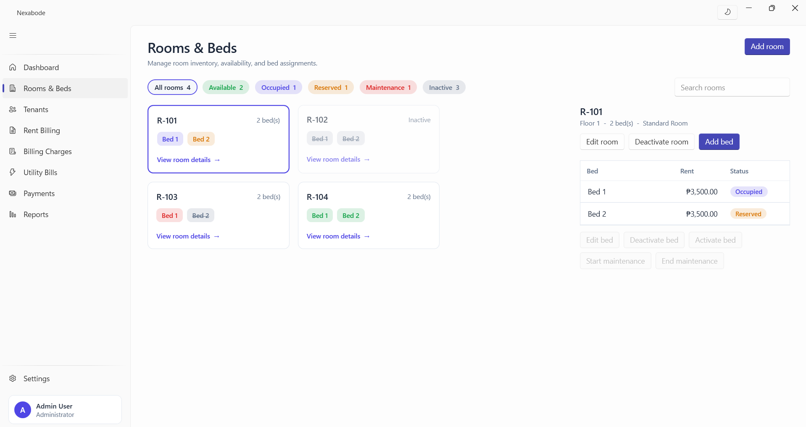</td>
  </tr>
  <tr>
    <td width="50%"><sub><b>03 / RENT BILLING</b></sub><br>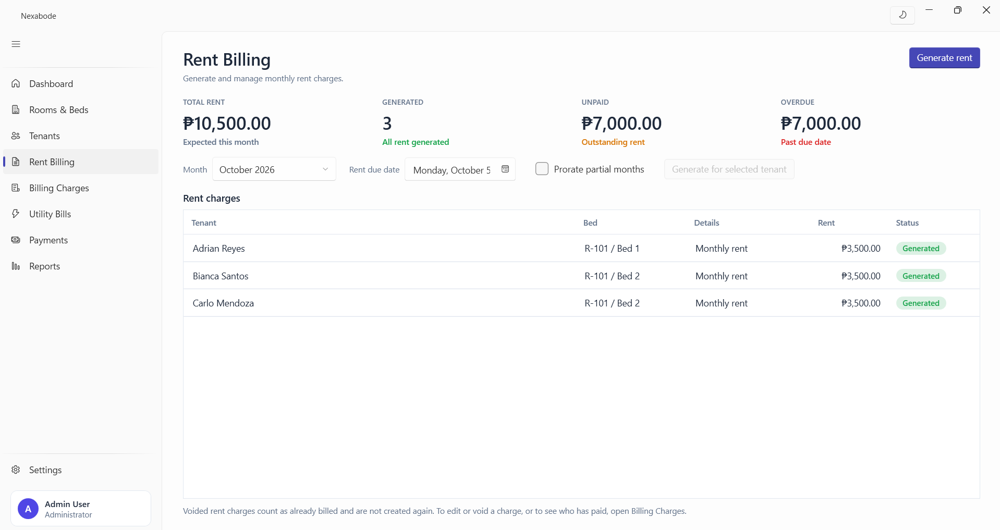</td>
    <td width="50%"><sub><b>04 / PAYMENTS</b></sub><br>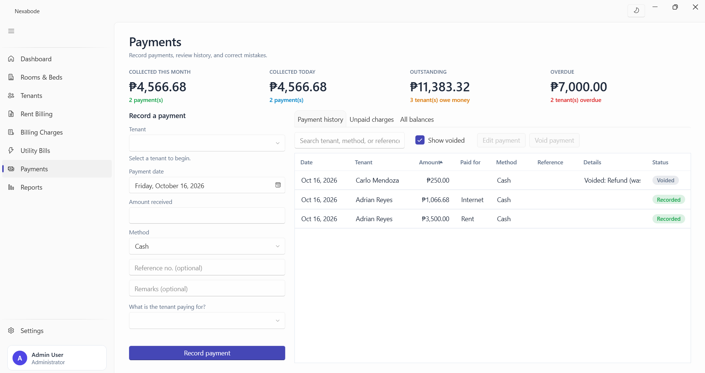</td>
  </tr>
  <tr>
    <td width="50%"><sub><b>05 / BILLING CHARGES</b></sub><br>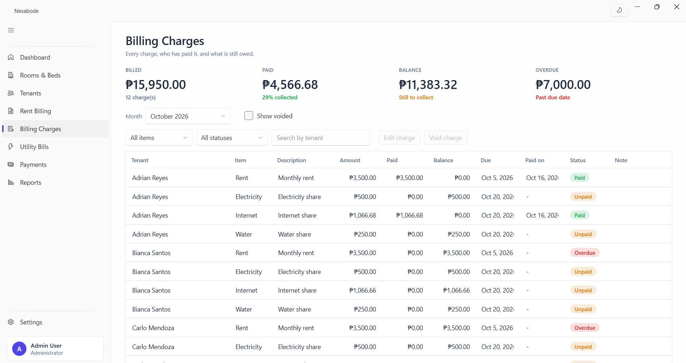</td>
    <td width="50%"><sub><b>06 / REPORTS</b></sub><br>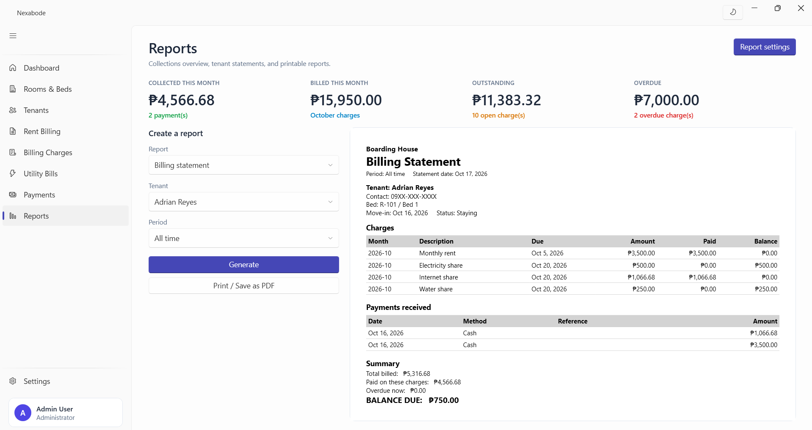</td>
  </tr>
</table>

## Features

<table>
  <tr>
    <td width="33%">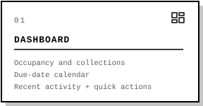</td>
    <td width="33%">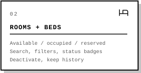</td>
    <td width="33%">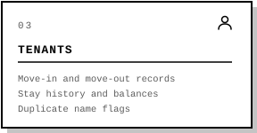</td>
  </tr>
  <tr>
    <td width="33%">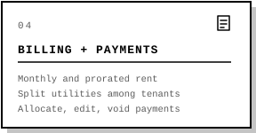</td>
    <td width="33%">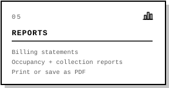</td>
    <td width="33%">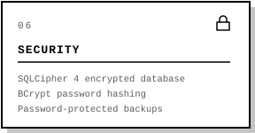</td>
  </tr>
</table>

<details>
<summary><b>Full feature list</b></summary>

<br>

**Dashboard**

- Overview of occupancy, monthly collections, and outstanding balances.
- Calendar for rent due dates, payments, utility bills, and tenant move-ins and move-outs.
- Recent activity, quick actions, and backup reminders.

**Rooms and Beds**

- Manage rooms and beds with search, filters, and visual status indicators.
- Track available, occupied, reserved, maintenance, and inactive beds.
- Activate or deactivate rooms and beds while preserving historical records.

**Tenant Management**

- Search and manage tenant records, occupancy status, and balances.
- Record move-ins and move-outs and review tenant stay history.
- Manage tenant deposits, and correct any stay (bed, dates, rent, deposit) with a recorded reason.
- Overlapping stays are blocked on new move-ins and flagged as warnings when correcting history.
- Archive settled, moved-out tenants and flag potentially duplicate names.

**Billing and Payments**

- Generate monthly rent charges with optional day-based proration.
- Record electricity, water, and other utility bills and split eligible expenses among tenants.
- Review, edit, void, archive, and restore billing records.
- Record payments and allocate them to outstanding charges using different methods. A payment larger than the balance is accepted, and the extra is shown as change to return.
- Bill utilities for periods that span months, and keep rent and utility charges in step when stay dates are corrected. Paid charges are never altered; differences become adjustment charges.
- Review exactly which records a change affects before you apply it.
- Apply deposits to unpaid balances and record full or partial deposit refunds.
- Search payment history and manage archived or voided transactions.

**Reports and Printing**

- Generate tenant billing statements, occupancy reports, and collection reports.
- Print reports or save them as PDFs using the Windows print dialog.
- Include the boarding house name and address in report headers.

**Security and Data Protection**

- Locally stored, encrypted SQLite database using the SQLCipher 4 file format.
- Password hashing using BCrypt and a required password change on first sign-in.
- Password-protected database backup and restore, with automatic backup reminders.
- Database safeguards against duplicate rent charges and utility splits.
- Protection intended to prevent multiple application instances from running simultaneously.
- Change history recording the original value, new value, administrator, time and reason of corrections.
- An automatic safety copy of the database before an upgrade.

**Customization**
- Light and dark themes.

These features provide safeguards, but they should not be interpreted as a guarantee that the application is immune to unauthorized access, data loss, or other security issues.

</details>

## How It Works

<table>
  <tr>
    <td width="33%">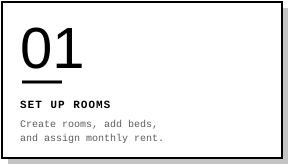</td>
    <td width="33%">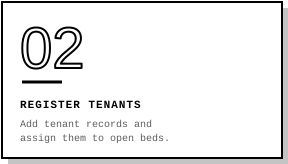</td>
    <td width="33%">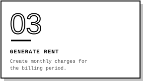</td>
  </tr>
  <tr>
    <td width="33%">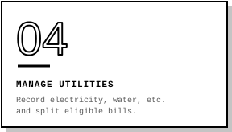</td>
    <td width="33%">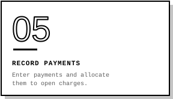</td>
    <td width="33%">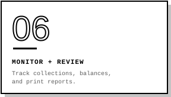</td>
  </tr>
</table>

## Download

1. Visit the [**latest release**](https://github.com/kvrtrss/Nexabode/releases/latest).
2. Download the Windows x64 ZIP asset attached to the release.
3. Extract the ZIP to a folder, such as `C:\Nexabode`.
4. Open `Nexabode.exe`.

The self-contained release includes the .NET runtime required by the application. No separate .NET installation should be necessary for the published Windows x64 build.

> [!WARNING]
> **Windows may show "Windows protected your PC".** The release is not code-signed, so Windows cannot verify the publisher. Do not bypass the warning automatically. Confirm the ZIP came from the official [Nexabode GitHub Releases page](https://github.com/kvrtrss/Nexabode/releases) and compare its SHA-256 checksum with the value in the release notes.

<details>
<summary><b>Verify the download (SHA-256)</b></summary>

<br>

Open PowerShell in the folder containing the downloaded file and run:

```powershell
Get-FileHash .\Nexabode-x.y.z-win-x64.zip -Algorithm SHA256
```

**Example:** for `Nexabode-1.0.0-win-x64.zip`, run:

```powershell
Get-FileHash .\Nexabode-1.0.0-win-x64.zip -Algorithm SHA256
```

Compare the resulting hash with the SHA-256 value published for that exact release asset. A matching hash verifies that the file matches the published checksum; it does not independently prove that the software is free from vulnerabilities.

</details>

### First sign-in

<p>
  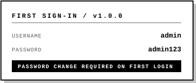
</p>

The application requires the default password to be changed on first sign-in. Change it immediately and do not reuse the default credentials elsewhere.

## Data Storage and Backups

Nexabode keeps everything on your computer, in `%LocalAppData%\Nexabode`.

<p>
  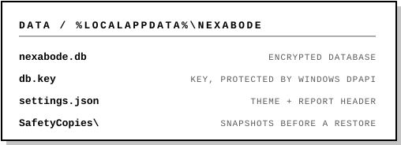
  
Before the first start after an upgrade that changes the database, Nexabode also saves a safety copy of it in the `SafetyCopies` folder. A normal backup from **Settings** is still the copy to rely on.
</p>

> [!IMPORTANT]
> The database key is protected using the Windows Data Protection API (DPAPI) under the Windows account used by the application.
>
> **Do not assume that copying the database alone is enough to preserve your records.** If the computer is lost or reformatted, the Windows profile is deleted, or the encryption key becomes unavailable, the database may not be recoverable without a valid backup.

Anyone who gains access to your Windows account may also be able to access information available to that account. Use a strong Windows password, lock your computer when unattended, and consider enabling BitLocker where supported.

### Create a Backup

1. Open **Settings** and select **Create backup**.
2. Choose a backup password of at least eight characters.
3. Save the resulting `.nexabak` file.
4. Store a copy somewhere separate from your computer, such as an external drive or trusted cloud storage.

The backup password is separate from your Nexabode sign-in password. **Keep it safe.** If it is forgotten and cannot be recovered by the application, the backup may be unusable. Back up regularly and verify that your backups can be restored before depending on them.

### Restore or Move to Another Computer

1. Create a backup on the original computer using **Settings → Create backup**.
2. Transfer the `.nexabak` file to the new computer.
3. Open Nexabode on the new computer and follow the initial sign-in process if it is a fresh installation.
4. Select **Settings → Restore from backup**.
5. Choose the backup file and enter its backup password.
6. Reopen the application and sign in with the credentials associated with the restored data.

Test the restored database and verify important records before relying on it. Keep an independent copy of the backup until you have confirmed that the restored data is correct.

## Security Notes

- The database is encrypted, but encryption does not protect against every threat, including all forms of access through a compromised Windows account.
- Anyone with sufficient access to your Windows account may be able to access application data. Keep Windows secured and up to date.
- Nexabode currently uses a single administrator account rather than a multi-user role system.
- There is no guaranteed password-recovery mechanism. Forgotten passwords or unavailable encryption keys may result in inaccessible data.
- Keep backups separate from the computer and protect them with a strong backup password.
- Do not commit databases, encryption keys, backups, real tenant information, or credentials to the repository.
- Review the [security policy](SECURITY.md) for information about reporting potential vulnerabilities.

## Disclaimer

Nexabode is provided **"AS IS"**, without warranties of any kind, express or implied, to the fullest extent permitted by applicable law. The authors and copyright holders do not guarantee that the software will be error-free, uninterrupted, secure, or suitable for a particular purpose.

Users are responsible for verifying records, maintaining appropriate backups, protecting access to their computers, and evaluating the software before relying on it for important operations.

Nexabode should be tested carefully before being used to manage real tenant records, financial information, or other sensitive data. Encryption and other security measures reduce certain risks but do not eliminate every possible risk.

Nothing in this disclaimer excludes or limits liability that cannot lawfully be excluded or limited under applicable law.

## Build from Source

**Requirements:** Windows 10 or 11, Git, and the [.NET 10 SDK](https://dotnet.microsoft.com/download) (or Visual Studio 2026 with the **.NET desktop development** workload).

```powershell
git clone https://github.com/kvrtrss/Nexabode.git
cd Nexabode/Nexabode
dotnet run
```

Run the tests from the repository root:

```powershell
dotnet test Nexabode.Tests/Nexabode.Tests.csproj
```

Alternatively, open `Nexabode/Nexabode.slnx` in Visual Studio and run the application using **F5**.

<details>
<summary><b>Build and publish a release</b></summary>

<br>

From the application project directory:

```powershell
dotnet build .\Nexabode.csproj -c Release
```

To publish a self-contained Windows x64 build:

```powershell
dotnet publish .\Nexabode.csproj -c Release -r win-x64 --self-contained true -o .\publish\win-x64
```

</details>

<details>
<summary><b>Project layout</b></summary>

<br>

```text
Nexabode/
├── .github/             GitHub workflows and templates
├── docs/                Banner, badges, and screenshots
├── Nexabode/            Application project and solution
│   ├── Controls/        Reusable interface components
│   ├── Data/            Database, encryption, and startup logic
│   ├── Models/          Database entities
│   ├── Services/        Business rules, settings, and utilities
│   └── Views/           Application pages and dialogs
├── Nexabode.Tests/      Unit and scenario tests for the billing, stay and payment rules
├── ACCESSIBILITY.md     Accessibility goals and reporting
├── CHANGELOG.md         Release history
├── CODE_OF_CONDUCT.md   Community behavior guidelines
├── CONTRIBUTING.md      Contribution instructions
├── LICENSE              MIT License
├── README.md            Project overview and documentation
└── SECURITY.md          Security policy
```

The layout above describes the intended repository organization. Directory names may change as the project evolves.

</details>

## Contributing

Bug reports, documentation improvements, feature suggestions, and code contributions are welcome. Before making a substantial change, consider opening an issue to discuss the proposal.

- **Use fictional data.** Never publish real tenant information, financial records, passwords, or encryption keys in issues, screenshots, commits, or pull requests.
- **Protect sensitive files.** Never commit `.db`, `.key`, or `.nexabak` files.
- **Verify your changes.** Build the application in Release configuration and manually test the affected functionality.
- **Describe your work.** Explain the change, its purpose, and the verification you performed.

See [CONTRIBUTING.md](CONTRIBUTING.md) for the contribution process and [CODE_OF_CONDUCT.md](CODE_OF_CONDUCT.md) for community expectations. Accessibility feedback is also welcome; see [ACCESSIBILITY.md](ACCESSIBILITY.md).

## Built With

| Component | Role |
|---|---|
| **C# and .NET 10** | Application logic and runtime |
| **Windows Presentation Foundation (WPF)** | Desktop user interface |
| [WPF-UI](https://github.com/lepoco/wpfui) | Modern WPF controls and styling |
| [Entity Framework Core](https://learn.microsoft.com/ef/core/) with SQLite | Data access and database management |
| [SQLite3 Multiple Ciphers](https://github.com/utelle/SQLite3MultipleCiphers-NuGet) | Encrypted database support |
| [BCrypt.Net-Next](https://github.com/BcryptNet/bcrypt.net) | Password hashing |
| [CommunityToolkit.Mvvm](https://github.com/CommunityToolkit/dotnet) | MVVM utilities |

These projects are maintained by their respective authors and communities. Refer to the applicable package licenses and notices for details about third-party software included with Nexabode.

## AI Assistance

AI tools were used during development as aids for programming, debugging, documentation, and technical problem-solving:

- **ChatGPT by OpenAI** — development discussions, code analysis, troubleshooting, documentation, and release preparation.
- **Claude by Anthropic** — development tasks, code review, and technical problem-solving.

AI-generated suggestions and outputs were evaluated and adapted as appropriate. The project maintainer remains responsible for the project's implementation, testing, final decisions, and maintenance. AI tools served as development assistants; they are not project maintainers or substitutes for human review.

## License

Nexabode is released under the [MIT License](LICENSE).

<br>

<div align="center">
  <a href="https://github.com/kvrtrss">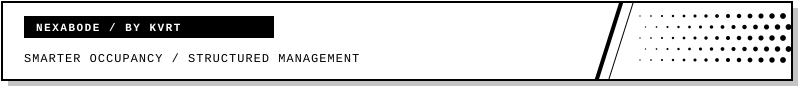</a>
</div>
